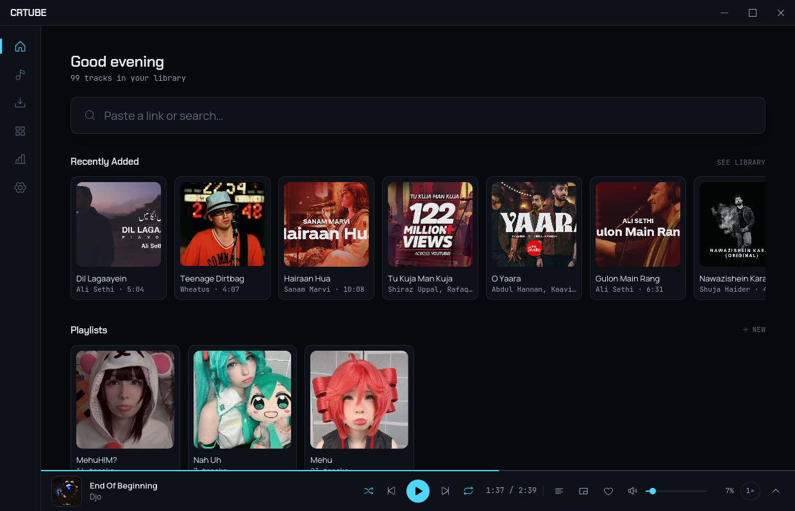

# CRTube

<p align="center">
  
</p>

<p align="center">
  <a href="https://github.com/SlyHammad18/CRTube/releases/latest"></a>
  
  
</p>

CRTube is a desktop YouTube downloader and music player. Search, pick a format,
queue the download, and play it back with lyrics, playlists, and stats.
Everything runs on your machine with yt-dlp and ffmpeg. No accounts, no
telemetry.

## Features

- Search YouTube or paste a link, pick audio/video quality, and download with a
  live progress queue
- Built-in player with a persistent queue, shuffle, repeat, speed, and volume
- Live streaming: play straight from YouTube before the download finishes
- Synced lyrics from LRCLIB, a lyrics dock, and an optional always-on-top
  floating lyrics window
- Playlists, favourites, artist pages, custom artwork, and track renaming
- Listening stats: play counts, total listening time, charts per day, week,
  month, and year, plus top songs and top artists
- Desktop integration: MPRIS media keys and a desktop media widget, keyboard
  shortcuts, resumable playback
- yt-dlp keeps itself updated with checksum-verified downloads; artwork and
  thumbnails are cached locally

## Latest release

**v0.7.0** adds the Stats tab: it tracks every listen and shows total listening
time, plays, per day/week/month/year charts, top songs, and top artists.

Full notes live on the [releases page](https://github.com/SlyHammad18/CRTube/releases).

## Download

Grab the `.deb` from the
[releases page](https://github.com/SlyHammad18/CRTube/releases) for Debian and
Ubuntu. Windows installers and AppImage are not shipped yet.

## Build from source

Requirements: Node.js 20+, Rust, and the Tauri 2 system dependencies for your
platform (WebKitGTK and libsoup on Linux; WebView2 SDK and Visual Studio Build
Tools on Windows).

```bash
npm install
npm run tauri build -- --bundles deb   # Linux
npm run tauri build -- --bundles nsis  # Windows
```

Artifacts land in `src-tauri/target/release/bundle/`.

For development with hot reload:

```bash
npm run tauri dev
```

## Contributing

PRs are welcome. Keep them small, run the checks, and see
[CONTRIBUTING.md](CONTRIBUTING.md) for the details.

## License

MIT, see [LICENSE](LICENSE).
